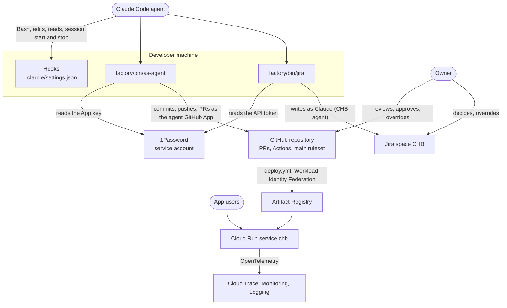
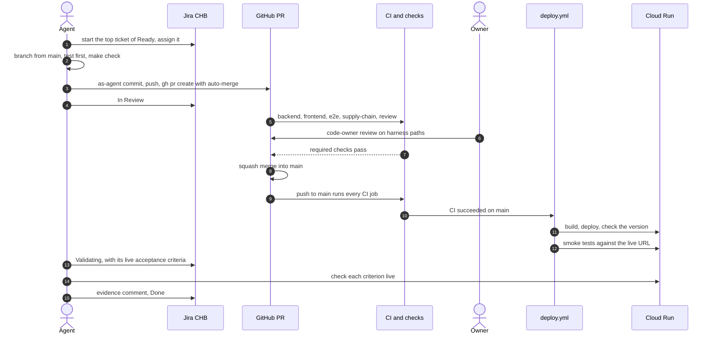

<!-- START doctoc generated TOC please keep comment here to allow auto update -->
<!-- DON'T EDIT THIS SECTION, INSTEAD RE-RUN doctoc TO UPDATE -->
**Table of Contents** *generated with [DocToc](https://github.com/thlorenz/doctoc)*

- [Contributing](#contributing)
  - [Start here](#start-here)
  - [How the pieces fit](#how-the-pieces-fit)
  - [How a change ships](#how-a-change-ships)
  - [Where the rules live](#where-the-rules-live)
  - [Diagrams](#diagrams)

<!-- END doctoc generated TOC please keep comment here to allow auto update -->

# Contributing

This file is the entry point for a new developer, human or agent.
It links to the rules and repeats none of them: when a link and this file disagree, the link wins.

## Start here

1. Read the disclaimer and the question at the top of [`README.md`](README.md): this repository is a learning experiment run by AI agents.
2. Install Docker, GNU Make, [uv](https://docs.astral.sh/uv/) and Node 24, then run the commands in [README, Quick start](README.md#quick-start).
   `make setup` installs a git pre-commit hook that runs `make check`, so a commit that breaks lint, types or tests never leaves your machine.
3. Read [`CLAUDE.md`](CLAUDE.md). Agents follow it, and it is the shortest list of the rules every change must respect.
4. Open the [Jira board `CHB`](https://islomar.atlassian.net/jira/software/projects/CHB/boards/2) (sign-in required) and read [`docs/process/kanban.md`](docs/process/kanban.md).
   All work is a ticket. No ticket, no branch.

How work is picked and tracked:

- Agents work only on what is needed now. New tickets go to Backlog.
  A ticket moves to Ready only with a named trigger and a Definition of Ready that holds ([kanban.md, Backlog](docs/process/kanban.md#backlog)).
- Work follows the owner's priorities, not an agent's choice: agents start only the top ticket of Ready, and priority sets the order
  ([`docs/process/priorities.md`](docs/process/priorities.md)).
- Finishing comes before starting. WIP limits on the board refuse a new start while review or live checks pile up:
  exit 5 means a full column (run the wait command it prints in the background), exit 4 any other board rule
  ([kanban.md, WIP limits](docs/process/kanban.md#wip-limits)).
- The owner finds every blocker in one place. A step only the owner can take (a decision, a payment, a console click) moves the ticket to Needs human,
  with numbered owner steps in the ticket.
- Jira history must show who did what, and the board rules must not be bypassed.
  Agents make every Jira write through `factory/bin/jira`, which acts as the agent's own account and enforces the rules, never with the owner's login.

## How the pieces fit

People and agents build the app on a laptop, ship it through GitHub, and run it on Google Cloud.
The agent never uses the owner's logins: two wrappers act as the agent's own accounts.

Details: identities in [ADR-d7b7](docs/decisions/ADR-d7b7-agent-github-identity.md) and [`factory/README.md`](factory/README.md),
deploy in [ADR-d5e6](docs/decisions/ADR-d5e6-deploy-on-cloud-run.md), runtime and telemetry in [README, Observability](README.md#observability).

## How a change ships

One ticket, one branch `CHB-<n>-<slug>`, one squash-merged pull request.
Merged is not done: a ticket is done when its acceptance criteria hold in production, with evidence on the ticket.

The rules behind each step:

- Board statuses, WIP limits, Definition of Ready: [`docs/process/kanban.md`](docs/process/kanban.md).
- Priorities: [`docs/process/priorities.md`](docs/process/priorities.md).
- Workflows, required checks and their triggers: [`docs/process/delivery-pipeline.md`](docs/process/delivery-pipeline.md).
- Short-lived branches: [ADR-0faf](docs/decisions/ADR-0faf-short-lived-branches.md). Definition of done: [ADR-ad3e](docs/decisions/ADR-ad3e-definition-of-done.md).
- Automated PR review and its scores: [ADR-ea8c](docs/decisions/ADR-ea8c-automated-pr-review.md).
- Dependabot updates: [ADR-ebe6](docs/decisions/ADR-ebe6-unattended-dependency-updates.md).

## Where the rules live

| Kind | Where |
|---|---|
| Rules every change follows | [`CLAUDE.md`](CLAUDE.md) |
| Decisions and their reasons | [`docs/decisions/`](docs/decisions/README.md) |
| How work moves | [`docs/process/`](docs/process/kanban.md) |
| Learnings from past mistakes | [`docs/knowledge/`](docs/knowledge/) |
| Agent wrappers, hooks, PR review | [`factory/README.md`](factory/README.md) |
| Terraform for Google Cloud and GitHub | [`infra/README.md`](infra/README.md) |
| Commands | `make help` |
| Product specs | [`docs/specs/`](docs/specs/) |
| Epics | [`TODO.md`](TODO.md) |

A rule that can be a check is a check: a hook in `factory/hooks/`, a test, or a step of `make check`.
Learnings go in this repository, never in an agent's personal memory ([ADR-eedb](docs/decisions/ADR-eedb-learnings-live-in-the-repo.md)).

## Diagrams

Every Mermaid diagram in the repository, next to the text it explains:

| Diagram | Where |
|---|---|
| How the pieces fit | [How the pieces fit](#how-the-pieces-fit) |
| How a change ships | [How a change ships](#how-a-change-ships) |
| Ticket lifecycle | [`docs/process/kanban.md`, Flow](docs/process/kanban.md#flow) |
| GitHub workflows and triggers | [`docs/process/delivery-pipeline.md`](docs/process/delivery-pipeline.md) |
| Runtime and telemetry | [README, Observability](README.md#observability) |
| Identities at a glance | [`factory/README.md`, Identities at a glance](factory/README.md#identities-at-a-glance) |
| Hooks at a glance | [`factory/README.md`, Hooks at a glance](factory/README.md#hooks-at-a-glance) |

A new diagram gets a row here in the same PR.
