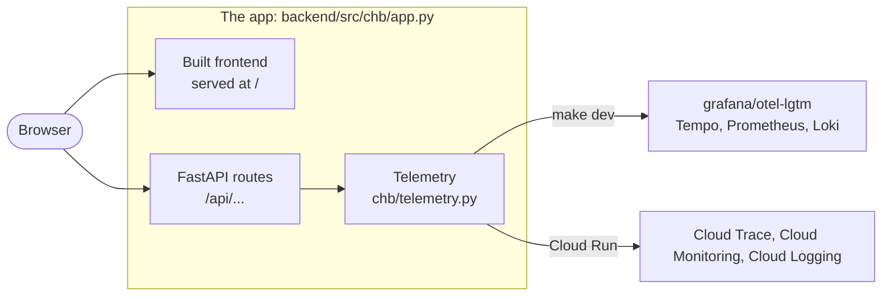

<!-- START doctoc generated TOC please keep comment here to allow auto update -->
<!-- DON'T EDIT THIS SECTION, INSTEAD RE-RUN doctoc TO UPDATE -->
**Table of Contents** *generated with [DocToc](https://github.com/thlorenz/doctoc)*

- [Corporate Hotel Booking: software factory experiment](#corporate-hotel-booking-software-factory-experiment)
  - [Quick start](#quick-start)
  - [API documentation](#api-documentation)
  - [Observability](#observability)
    - [Local: Grafana](#local-grafana)
    - [Production: Google Cloud console](#production-google-cloud-console)
    - [How export works on Cloud Run](#how-export-works-on-cloud-run)
  - [Sandbox container](#sandbox-container)
  - [Layout](#layout)
  - [Process](#process)

<!-- END doctoc generated TOC please keep comment here to allow auto update -->

# Corporate Hotel Booking: software factory experiment

[](https://github.com/islomar/corporate-hotel-booking-software-factory/actions/workflows/ci.yml)
[](https://github.com/islomar/corporate-hotel-booking-software-factory/actions/workflows/deploy.yml)
[](https://chb-1027266991110.europe-west1.run.app)


> [!NOTE]
> **Disclaimer:** This repository is a LEARNING experiment 👨‍🔬🧪
>
> - I try things here that I would not always do in real-life development.
> - AI agents write most of the code, under the checks in [Process](#process).
> - The production app is a demo: no real bookings, no uptime promise. Do not enter personal data.

- Production: <https://chb-1027266991110.europe-west1.run.app>
- API reference (OpenAPI): <https://chb-1027266991110.europe-west1.run.app/api/docs>
- Work tracking (Jira board `CHB`, sign-in required): <https://islomar.atlassian.net/jira/software/projects/CHB/boards/2>
- New here? Start with [`CONTRIBUTING.md`](CONTRIBUTING.md).

A web app built from the Codurance kata [Corporate Hotel Booking](https://www.codurance.com/katas/corporate-hotel-booking), developed through an AI-agent software factory.

The experiment combines two sources:

- The 540 talk "Del humano en el bucle al desarrollo desatendido": skills, code workflows, an orchestrator, PR scoring, evidence per acceptance criterion.
- eferro's post [Turning up the dial](https://www.eferro.net/2026/10/turning-up-dial-seeing-forest-while.html): small safe steps, learnings in the repo, rules as checks, `validating` before done.

**The question**: how close can delivery get to fully unattended while the results stay trustworthy? Delegation rises only as fast as the checks underneath it.

## Quick start

Requirements: Docker, GNU Make. For running checks outside Docker: [uv](https://docs.astral.sh/uv/) and Node 24.

```sh
make setup   # dependencies, Playwright browser, git pre-commit hook
make dev     # backend and frontend with hot reload: http://localhost:5173
             # Grafana with the app's traces, metrics and logs: http://localhost:3000
make down    # stop the containers
make clean-dev  # remove this checkout's containers and volumes (run it when done with make dev in a worktree)
make check   # lint, typecheck and tests (the pre-commit gate); agents: .devcontainer/run make check
make up      # production image: http://localhost:8080
make e2e     # Playwright against the production image
make help    # all targets
```

`make e2e` needs Node 24 (run `nvm use`) and Docker.
It installs the e2e dependencies and the Playwright browser when they are missing.
If the app from `make up` answers on port 8080, it tests that app and leaves it running.
Otherwise it builds and starts the production container, runs the tests, and removes the container.
`make dev` does not get in the way: it uses ports 5173, 8000 and 3000.

To test an app that runs elsewhere, set `APP_URL`. Then `make e2e` starts nothing:

```sh
APP_URL=https://chb-1027266991110.europe-west1.run.app make e2e
```

To pass arguments to Playwright, run the script directly: `python3 scripts/run_e2e.py --headed`.

## API documentation

FastAPI generates an [OpenAPI 3.1](https://spec.openapis.org/oas/v3.1.0) schema from the route type hints and pydantic models.
The schema cannot drift from the code because the code is its source.

| Path | Content |
|---|---|
| `/api/docs` | Swagger UI: browse and call the endpoints |
| `/api/openapi.json` | The raw schema, for clients and contract checks |

Locally the same paths work on <http://localhost:5173> (`make dev`) and <http://localhost:8080> (`make up`).
On <http://localhost:8000> (the `make dev` backend alone) the Swagger UI page has no assets: the dev server on port 5173 provides them.

The backend sends a strict `Content-Security-Policy` and other security headers on every response (`backend/src/chb/security_headers.py`).
Swagger UI comes from the `swagger-ui-dist` npm package, copied into the frontend build and served from `/api/docs-assets`, so the policy names no CDN.
ReDoc is off: it has no self-hosted copy.

## Observability

The backend sends traces, metrics and logs with OpenTelemetry ([ADR-c17d](docs/decisions/ADR-c17d-observability-with-opentelemetry.md)).
The code is the same everywhere. Only the destination changes:



Under `make dev`, Vite serves the frontend on port 5173 and the backend runs on port 8000.

| | Local (`make dev`) | Production (Cloud Run) |
|---|---|---|
| Where you look | Grafana at <http://localhost:3000>, no login | Google Cloud console, project `chb-factory-a92932` |
| Traces | Tempo | Cloud Trace |
| Metrics | Prometheus | Cloud Monitoring |
| Logs | Loki | Cloud Logging |
| Data kept | In memory: `make down` discards it | Logs 30 days; traces and metrics per Google's defaults |
| Who can see it | Anyone on your machine | Google accounts with access to the project |

Tests, CI and `make up` export nothing: logs go to stdout as JSON, with no traces or metrics.

### Local: Grafana

`make dev` starts the `grafana/otel-lgtm` container next to the app.
Open <http://localhost:3000>, then **Explore**, and pick a data source:

- **Tempo** (traces): search `{resource.service.name="chb"}`.
- **Prometheus** (metrics): query `http_server_request_duration_seconds_count`.
- **Loki** (logs): query `{service_name="chb"}`.

Health checks (`/api/health`) produce metrics, but no traces and no access log lines.
To create traces and logs, open <http://localhost:5173/api/docs> and reload it a few times.

### Production: Google Cloud console

Log in with a Google account that has access to project `chb-factory-a92932`.
To create data, open <https://chb-1027266991110.europe-west1.run.app/api/docs> and reload it a few times.

| Signal | Open | What to do there |
|---|---|---|
| Traces | [Trace Explorer](https://console.cloud.google.com/traces/explorer?project=chb-factory-a92932) | Set the time range to the last hour. Each dot is a request; click one to see its spans. |
| Logs | [Logs Explorer](https://console.cloud.google.com/logs/query?project=chb-factory-a92932) | Query `resource.type="cloud_run_revision" resource.labels.service_name="chb"`. A log line written during a request links to its trace. |
| Metrics | [Metrics Explorer](https://console.cloud.google.com/monitoring/metrics-explorer?project=chb-factory-a92932) | Select the metric `prometheus.googleapis.com/http.server.request.duration/histogram` (search `request.duration`), group by `http.route`. Points arrive once a minute. |
| Overview | [Cloud Run metrics tab](https://console.cloud.google.com/run/detail/europe-west1/chb/metrics?project=chb-factory-a92932) | Request count, latency, instances and errors, with no query. |

From a terminal, the same log search:

```sh
gcloud logging read 'resource.labels.service_name="chb" AND jsonPayload.message:"GET /api/openapi.json" AND traceSampled=true' --limit 1 --format=json
```

Each JSON log line carries `logging.googleapis.com/trace` and `logging.googleapis.com/spanId`.
Cloud Logging moves them to the entry's `trace`, `spanId` and `traceSampled`, which is how a log line links to its trace.
Health checks write no access log line.

### How export works on Cloud Run

Cloud Run throttles CPU after the response goes out.
The backend holds back the last chunk of each response until it has exported the spans and logs of that request.
It exports metrics from the same place, at most once a minute.
One thread runs flushes, one at a time; concurrent responses share the next flush.
A response waits at most 2 s for a flush. After a span and log flush that fails or takes over 0.5 s, responses skip flushing for 30 s.
If telemetry setup fails at startup, the app logs one warning and runs without export.
The backend decides sampling itself: health checks (`/api/health`) get request metrics but no traces and no access log line, every other request is traced.
The sampled flag in an incoming `traceparent` header is ignored; its trace ID is kept.

## Sandbox container

Package installs, linters and tests run code from npm and PyPI.
`.devcontainer/run <command>` runs such a command in a container, so that code never runs on the host:

```sh
.devcontainer/run make check
.devcontainer/run bash -c 'cd backend && uv run --locked pytest tests/test_health.py'
```

A Claude Code hook (`factory/hooks/route_to_sandbox.py`) denies these commands on the host and names this form.
The git pre-commit hook runs `make check` here too. You need Docker; the first run builds the image (about a minute).

What the container gets:

- No secret. No host environment variable, keyring, 1Password, Claude Code or Jira access. Commands that need a secret (`factory/bin/as-agent`, `factory/bin/jira`, `git push`) run on the host.
- The checkout, read-only, at its own path, so git worktrees work.
  Only `backend/` and `frontend/` are writable: the container cannot change a hook, script or Makefile that the host runs.
  Changes in those two folders show in `git status`; files git ignores there do not.
  An existing `backend/.venv` on the host is hidden behind an empty folder.
  If the container makes `backend/.venv`, or a `.git` in either folder, the launcher stops with exit code 3: the host could run code from it.
- The frontend's installed packages in a Docker volume per checkout (`chb-sandbox-nm-<hash>`), apart from the host folder.
  `npm ci` runs there when `frontend/package-lock.json` changes.
- A cache volume for uv and npm (`chb-sandbox-cache`).
- Outbound HTTPS only to the hosts in `.devcontainer/allowed-hosts.txt`.

At every start, `init-firewall.sh` (as root) resolves the listed hosts, adds GitHub's published address ranges and rejects any other outbound traffic.
If any step fails, it blocks all traffic but loopback and the command does not run.
Then `entry.sh` runs the command as user `agent`, with no capabilities and no sudo, so it cannot change the rules.
To test the firewall: `.devcontainer/run python3 -I /usr/local/share/devcontainer/egress.py check`.

Change the allow list:

1. Add one bare host name per line to `.devcontainer/allowed-hosts.txt`, with a comment that names the command that needs it. No scheme, port, path or wildcard.
2. Run `python3 -I -m unittest discover -s scripts/tests -p 'test_devcontainer_*.py'`.
3. The next `.devcontainer/run` builds a new image: the image tag is a hash of the files in `.devcontainer/`.

Limits:

- DNS is open: code in the container can resolve any name, and a DNS query can carry data out.
- The list holds IP addresses. A site that shares a CDN address with a listed host is reachable too (`www.python.org` shares one with `files.pythonhosted.org`).
- These gaps can leak only what the container holds: the public repository, without secrets.
- The agent session itself runs on the host with full network. Claude Code's permission rules and auto mode classifier guard it, not this container.
- `make dev`, `make up` and `make e2e` start their own containers and stay on the host.
- Remove the volumes of a deleted checkout: `docker volume ls --filter name=chb-sandbox-nm-`, then `docker volume rm <name>`.

## Layout

| Path | Content |
|---|---|
| `.devcontainer/` | Sandbox container for third-party code, egress allow list |
| `backend/` | FastAPI app, Python 3.15, uv |
| `frontend/` | React + TypeScript, Vite |
| `e2e/` | Playwright tests against the production container |
| `factory/` | Agent workflows, orchestrator, notifier |
| `scripts/` | Git hook and dependency checks |
| `docs/decisions/` | Decision records |
| `docs/specs/` | Product specs |
| `docs/knowledge/` | Learnings |
| `docs/assets/github-apps/` | Avatars of the agent and reviewer GitHub Apps: SVG source and the uploaded 512×512 PNG |
| `docs/postmortems/` | One per ticket |
| `docs/sessions/` | Curated agent session logs |

## Process

Pushes to `main` run CI. When CI passes, the deploy workflow builds the image, deploys it to Cloud Run, checks that `/api/health` reports the new commit, and runs Playwright against the live URL.

- Tasks live in Jira, space `CHB`: [board](https://islomar.atlassian.net/jira/software/projects/CHB/boards/2). [`docs/process/kanban.md`](docs/process/kanban.md) defines each status.
- Setup and factory work is tracked in Jira too. [`TODO.md`](TODO.md) lists the epics.
- One ticket, one short-lived branch, one pull request. See `docs/decisions/ADR-0faf-short-lived-branches.md`.
- Merged is not done. See `docs/decisions/ADR-ad3e-definition-of-done.md`.
- Dependabot updates arrive every weekday. Safe ones merge without a person once the setup in `docs/decisions/ADR-ebe6-unattended-dependency-updates.md` is complete.
