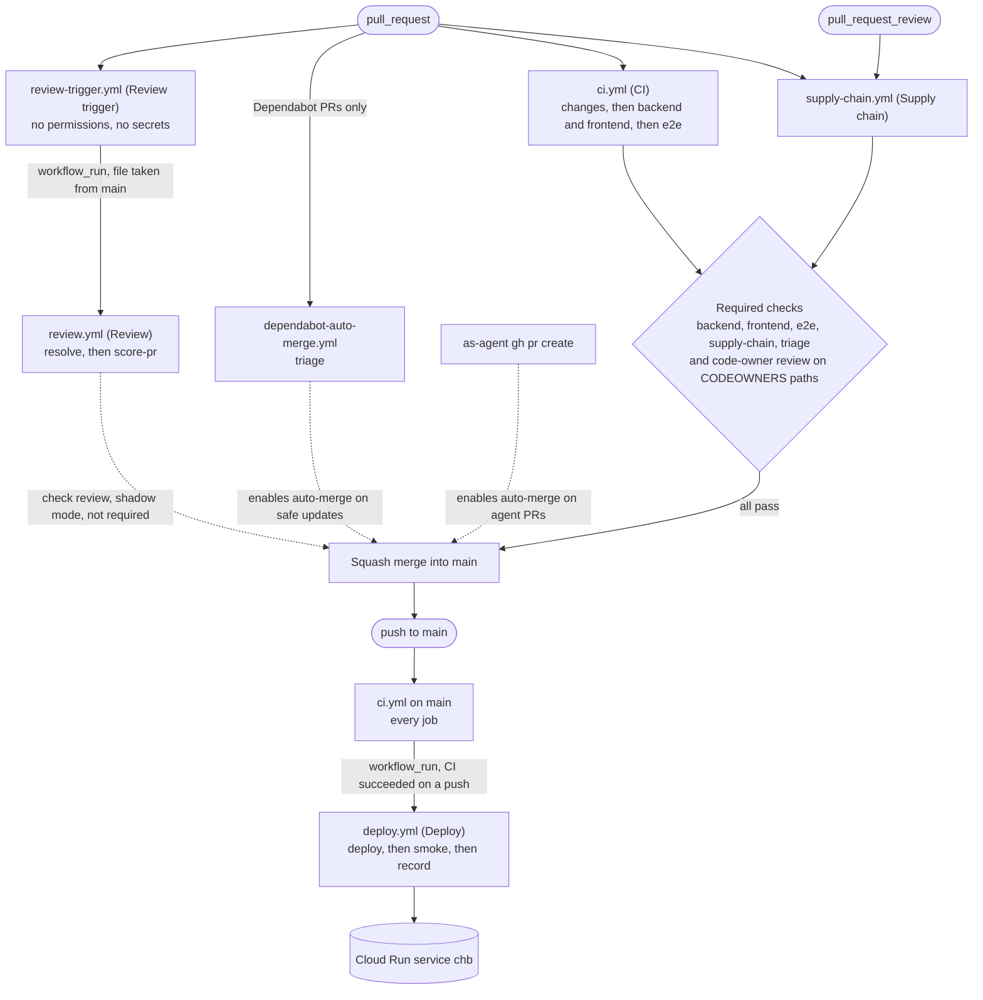

<!-- START doctoc generated TOC please keep comment here to allow auto update -->
<!-- DON'T EDIT THIS SECTION, INSTEAD RE-RUN doctoc TO UPDATE -->
**Table of Contents** *generated with [DocToc](https://github.com/thlorenz/doctoc)*

- [Delivery pipeline](#delivery-pipeline)
  - [Workflows and triggers](#workflows-and-triggers)
  - [Why two workflows chain through workflow_run](#why-two-workflows-chain-through-workflow_run)
  - [Required checks](#required-checks)

<!-- END doctoc generated TOC please keep comment here to allow auto update -->

# Delivery pipeline

How a pull request becomes a deploy: the GitHub Actions workflows in `.github/workflows/`, what starts each one, and which checks block a merge.
The workflow files hold the details in their comments. This page is the map.

## Workflows and triggers

- `ci.yml`: no change reaches `main` unless lint, types and tests pass.
  A text fix should not wait several minutes for tests it cannot break, so a docs-only pull request skips `backend`, `frontend` and `e2e`
  ([CHB-117](https://islomar.atlassian.net/browse/CHB-117), `factory/review/docs_list.py`). A push to `main` always runs every job.
- `review.yml`: the owner reads every agent diff today, and that does not scale.
  The goal is a scored review the owner can trust, so safe pull requests can later merge without a person.
  It scores each pull request against the [CHB-40](https://islomar.atlassian.net/browse/CHB-40) rubric and posts a comment the owner reacts to.
  Until those reactions show the scores can be trusted, it blocks nothing (shadow mode). It skips Dependabot and docs-only pull requests.
  See [ADR-ea8c](../decisions/ADR-ea8c-automated-pr-review.md).
- `supply-chain.yml`: keeps a malicious or broken dependency out of production.
  Attackers often publish a bad version that is caught within days, so new versions wait out a release age.
  A change to a manifest, lockfile, image or runtime pin passes only when every commit is Dependabot's, or the owner approved it.
  That lets safe Dependabot updates merge without a person, and makes a hand-made dependency change wait for the owner.
  See [ADR-ebe6](../decisions/ADR-ebe6-unattended-dependency-updates.md).
- `deploy.yml`: merged is not done. The smoke job proves that the live app runs the new commit and works, by checking `/api/health` and running Playwright against the live URL.
  The record job writes when each release happened and what it carried, so delivery speed and failure rate can be measured
  ([CHB-74](https://islomar.atlassian.net/browse/CHB-74)). See [ADR-d5e6](../decisions/ADR-d5e6-deploy-on-cloud-run.md).

## Why two workflows chain through workflow_run

The goal: code on a pull request branch never reaches a secret or the production credentials, even when the agent wrote that branch.
A `pull_request` workflow runs the copy of the file on the pull request's branch. A branch could edit it to read secrets.
A `workflow_run` workflow always runs the copy on `main`, so a branch cannot change it until the edit merges.

- Review: `review-trigger.yml` runs on the branch with no permissions and no secrets. Its completed run starts `review.yml` from `main`, which holds the reviewer secrets ([CHB-93](https://islomar.atlassian.net/browse/CHB-93)).
- Deploy: `deploy.yml` starts when CI completes on `main`, and runs only when that run succeeded on a push. Google Cloud trusts GitHub only for `refs/heads/main` ([ADR-d7b7](../decisions/ADR-d7b7-agent-github-identity.md)).
  The `workflow_run` branch filter matches a ref's short name, so a pushed tag named `main` passes it too ([CHB-173](https://islomar.atlassian.net/browse/CHB-173)).
  Its first job, `gate`, holds no credentials. It requires the run of `.github/workflows/ci.yml` and a commit on `main`, with `scripts/check_deploy_commit.py` taken from `main`.
  Every other job needs it. The `branch-named-tags` ruleset (`infra/github/ruleset.tf`) lets only the owner create a tag named `main`.

## Required checks

Every merge into `main` deploys to production, so the merge is the last point where a person or a check can stop a bad change.
The `main` ruleset (`infra/github/ruleset.tf`, list in `infra/github/repository.tf`) requires `backend`, `frontend`, `e2e`, `supply-chain` and `triage`.
The `triage` check (`triage.yml`, `triage-rerun.yml`, CHB-60) fails while the latest review has findings and the agent has not posted its triage of them.
It also requires the owner's review on the paths in `.github/CODEOWNERS`: the files that steer the agents, the pipeline and the infrastructure.
A change there changes the rules every later change runs under.
The `review` check is not required yet: it runs in shadow mode until stage 1 of [ADR-ea8c](../decisions/ADR-ea8c-automated-pr-review.md) ends.
