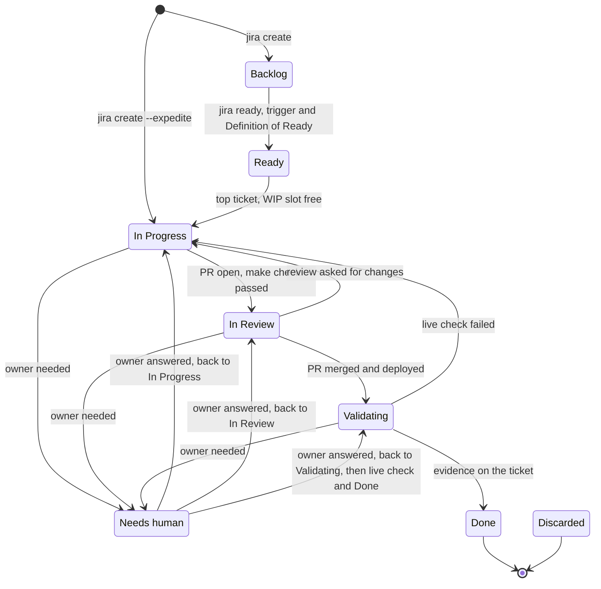

<!-- START doctoc generated TOC please keep comment here to allow auto update -->
<!-- DON'T EDIT THIS SECTION, INSTEAD RE-RUN doctoc TO UPDATE -->
**Table of Contents** *generated with [DocToc](https://github.com/thlorenz/doctoc)*

- [Kanban statuses](#kanban-statuses)
  - [WIP limits](#wip-limits)
  - [Flow](#flow)
  - [Statuses](#statuses)
    - [Backlog](#backlog)
    - [Ready](#ready)
    - [In Progress](#in-progress)
    - [In Review](#in-review)
    - [Validating](#validating)
    - [Needs human](#needs-human)
    - [Done](#done)
    - [Discarded](#discarded)
  - [Expedite](#expedite)
  - [Assignee](#assignee)

<!-- END doctoc generated TOC please keep comment here to allow auto update -->

# Kanban statuses

The board is the Jira space `CHB`.
Each status below has a meaning, rules to enter and rules to leave.
A ticket moves only when the rules to leave are true. Agents follow this document; the owner can override it, and the override is written as a comment on the ticket.

ADR-ad3e defines "done". This document makes it operational.
Priorities are defined in `priorities.md`. The rank in Ready decides the order of work, and `factory/bin/jira sort-todo` keeps that rank in the order of [Ready](#ready).

Columns, left to right (owner decision, 2026-11-10, CHB-153): Backlog, Ready, In Progress, In Review, Validating, Needs human, Done, Discarded.
Backlog holds work not needed yet. Ready holds work needed now. Agents pull only from Ready.
The owner added Backlog and renamed the column To Do to Ready on 2026-11-10. Ready (named To Do until that rename) still holds the status "To Do".
`factory/bin/jira` uses the column "Ready" when it exists, else "To Do". It never pulls from Backlog.

## WIP limits

The CHB board (board 2) holds the WIP limits: a min and a max per column, set by the owner in the board settings.
`factory/bin/jira transition` reads them from the board configuration on every move. The code holds no limit.

A WIP limit stops pulling new work. It never stops the board from recording what already happened (CHB-127).

- Max, starting work: a move from Ready into In Progress exits 5 while In Progress, In Review or Validating holds its max or more.
  The message names every full column, the limit and the tickets in it, and the wait command.
  The ticket stays in Ready. The agent comments on it, runs the wait command in the background and starts nothing else.
- Max, Needs human: a move into Needs human exits 5 while that column is full. The ticket stays where it is; the agent comments and runs the wait command in the background.
- Max, Ready: a move into Ready exits 4 while Ready is full (CHB-157, see [Ready](#ready)).
- Epics never count toward any column limit, min or max: the board shows no epic as a card (CHB-157).
- An [expedite](#expedite) ticket skips every limit and may take a column one over its max.
- Moves into In Review and Validating are never blocked: they record a PR opened or a PR merged. A column can go over its max, and Jira colours it.
- A move back into In Progress (review asked for changes, a live check failed, the owner answered) is not new work and is never blocked.
- Moves within one column, out of a column, or into a column without a max are never blocked.
- The max values live on the board only. This document does not repeat them.
- Min: a signal from the wrapper, enforced by a Stop hook, except for Ready, where it is a quota (see [Ready](#ready)). When a move leaves a column below its min,
  the wrapper prints `<column> is below its minimum (count/min)`, for example `In Progress is below its minimum (0/1)`.
  The Stop hook `factory/hooks/check_wip_minimums.py` (CHB-162, CHB-164) reads the board when the agent ends its turn and sends it back once when
  In Progress is below its min and Ready has a ticket that can start (it names the ticket), or when Ready is below its min (no reply text passes it;
  the reason lists the refill candidates). It fails open when Jira is unreachable and allows the stop on a
  second refusal for the same board.
- Waiting for a slot: exit 5 means a WIP limit (exit 4 is every other board refusal). Its message names a wait command.
  The agent runs it in the background (`run_in_background`): it retries the move every 120 seconds while the refusal is exit 5.
  Any other result ends it at once: exit 0 (moved), or a refusal such as exit 4 (not the top ticket, a missing section, a blocked ticket), which it prints.
  After 60 minutes it prints that the slot is still full and exits 1: the agent then tells the owner. The agent never waits longer than an hour without telling the owner.
- Exit 6: the move is done and Ready is below its min (see [Ready](#ready)). It is neither a refusal (exit 4) nor a full column (exit 5): the agent refills Ready.
- Free slots: after every move between columns, the wrapper prints the free In Progress slots and the next top tickets of Ready, one per free slot,
  for example `In Progress 2/3: 1 slot free; next: CHB-123` (CHB-125).
  The next tickets follow the sorted order of [Ready](#ready). A Backlog ticket is never next. A ticket that a start would refuse for a missing section is marked:
  `next: CHB-122 (needs acceptance criteria)` or `next: CHB-122 (needs Why it matters and acceptance criteria)`.
  It prints no such line while In Progress, In Review or Validating is at its max: starting is blocked then.
  The moved ticket is never next, and it blocks its dependents unless it moved to Done or Discarded (CHB-143).
- Pulling work: the agent fills In Progress up to its max, one agent per ticket, in parallel where it can (owner rule, 2026-11-10).
  It pulls the top tickets of Ready in rank order and needs no go per ticket. The owner can say stop at any time.
  Finishing comes first: before it pulls a ticket, the agent drives what it can in Validating, In Review and In Progress (live checks, review fixes, owner steps).
- Owner override: the owner moves the ticket in the Jira UI and writes why in a comment on the ticket.

Jira Free only colours a column over its limit. The check lives in `factory/bin/jira`.
A Claude Code hook in `.claude/settings.json` denies raw `acli` writes and direct REST writes, so agents cannot bypass the check.

## Flow

Not drawn, to keep the diagram readable: any open ticket can go back to Backlog (not needed now) or to Discarded (will not be done).
A ticket with nothing to deploy (a decision, an investigation) skips Validating and goes to Done once its output exists.
A ticket leaves Needs human for the status it came from.

## Statuses

### Backlog

Meaning: work that is not needed yet (owner decision, 2026-11-10, CHB-153). It stays visible on the board.

- Enter: a new ticket. `factory/bin/jira create` puts it here, always: `ready` moves it on (see Definition of Ready).
  On a board without a Backlog column, a new ticket stays in the pull list.
- Enter: an improvement the agent finds valuable. The ticket opens with its "Why it matters" section,
  and the agent tells the owner in one line. The owner's yes is trigger 2.
- Enter: any ticket that is not needed now, from any open status. `factory/bin/jira transition CHB-<n> Backlog` needs no trigger.
- Not sorted, no WIP limit. A Backlog ticket is never the top ticket, never "next", and never starts:
  a move from Backlog into any column other than Ready, Done or Discarded exits 4.
- Leave to Ready: only with a comment that names the trigger and its evidence. The five triggers:
  1. something is broken;
  2. the owner asked for it, directly or because it is in the product slice the owner agreed;
  3. it unblocks work in progress;
  4. the same pain appeared twice;
  5. Ready is below its minimum (owner decision, 2026-11-10, CHB-164). `factory/bin/jira ready` accepts this trigger, written as
     `5. Ready is below its minimum (<count>/<min>)`, only while Ready is below its minimum, and refuses it otherwise (exit 4).
     The refill takes the highest-priority, highest-ranked Backlog tickets that can meet the Definition of Ready.
     Where a candidate lacks acceptance criteria, the agent writes them first, or splits the ticket. The other boxes of the Definition of Ready still apply.

  The ticket's "Why it matters" section states the need and when the need becomes real, never the solution.
  The owner reads it to decide what can move to Ready.
- Definition of Ready (owner decision, 2026-11-10, CHB-154): every ticket has a section headed "Definition of Ready"
  with six Jira checkboxes, right after "Why it matters". A ticket moves from Backlog to Ready only when every box holds:
  1. Why it matters states the need and when it becomes real, never the solution. The agent ticks it; `ready` checks the section.
  2. Trigger named with evidence: one of the five triggers above. The agent ticks it; `ready` requires the trigger text and posts it.
  3. Acceptance criteria that can be checked (see [Ready](#ready)). `ready` verifies the section and ticks the box.
  4. Not blocked: every "is blocked by" ticket is Done or Discarded. `ready` verifies the links and ticks the box.
  5. No owner decision pending (money, lock-in, public exposure, deletion), or its decision ticket is Done.
     The agent ticks it. A pending decision is a decision ticket that blocks this one, so box 4 checks it too.
  6. Small: one PR, about a day of agent work; otherwise split it first. The agent ticks it.

  `factory/bin/jira create` adds the section. `factory/bin/jira checklist CHB-<n>` adds it to a ticket without it.
  The agent ticks a judgment box (1, 2, 5, 6) with `factory/bin/jira tick CHB-<n> why|trigger|decision|small`.
  A tick cannot replace a check: `ready` checks boxes 1, 3 and 4 again, ticked or not.
  Started tickets (In Progress, In Review, Validating) may keep their boxes unticked: they passed before the checklist existed.
- `factory/bin/jira ready CHB-<n> --trigger "<which trigger and its evidence>"` is the only way from Backlog to Ready.
  It exits 4 and names each open box while a box is unticked or a check fails, and the ticket stays in Backlog.
  Otherwise it ticks boxes 3 and 4, moves the ticket and comments `Moved to Ready. Trigger: <text>`.
  `factory/bin/jira transition` refuses the move (exit 2) and names `ready`. `create` always puts a ticket in Backlog.
- Owner go: agents pick work on their own. The owner's explicit go is needed only for:
  - spending money;
  - choosing between options with lock-in (vendor, provider, framework);
  - making something public;
  - deleting data.

  Such a go is a decision ticket that blocks the work (a "Blocks" link, see [Ready](#ready), Dependencies).
- Leave to Discarded: the work will not be done. Leave to Done: it is done already. Neither needs a trigger.

### Ready

Meaning: work needed now that nobody has started. Agents pull from it freely, top first.
Ready was named To Do until 2026-11-10 (CHB-153). The rules below apply to it under either name.

- Enter: the ticket has a summary, a description and a parent epic. From Backlog, only through `factory/bin/jira ready`: a trigger comment and a Definition of Ready that holds (see [Backlog](#backlog)).
- Why it matters (owner rule, 2026-11-10, CHB-148): every description opens with a section headed exactly "Why it matters", with text under it.
  It states the pain, who feels it (the owner, users of the hotel booking app, or agents) and the value of solving it,
  in 2 to 5 plain sentences without technical detail. Nothing comes before it. The technical sections follow.
  It states the need and when the need becomes real, never the solution. The owner reads it to decide what can move to Ready ([Backlog](#backlog), CHB-153).
  `factory/bin/jira create` refuses a description without it (exit 2, before any request).
  Add it to an existing ticket with `factory/bin/jira section CHB-<n> --heading "Why it matters" --first --body-file FILE`:
  the section goes at the top and the rest of the description stays as it is.
- Order (owner rule, 2026-11-10, CHB-148): Ready is sorted in this order. Backlog is not sorted.
  1. Tickets that can start: not an epic, and no open ticket blocks them. High, then Medium, then Low.
     A ticket without a priority counts as Medium.
  2. Tickets blocked by an open ticket.
  3. Epics.

  Each group keeps its rank order, so the owner's order within a priority stays.
  `factory/bin/jira sort-todo` applies the order and changes nothing when Ready is already sorted.
  `create` runs it after creating a ticket in Ready, and a start from Ready runs it before the top-ticket check.
  The rule decides the order: the sort undoes a hand rank across priorities or above a blocked ticket.
  To move a ticket up, the owner changes its priority, or ranks it within its priority.
- Leave to In Progress: someone starts working on it. Before that, the ticket has acceptance criteria that can be checked, and no open ticket blocks it.
- Top ticket: an agent picks the top ticket of Ready: the highest-ranked ticket that is not an epic and that no open ticket blocks.
  After the sort, it is the first ticket of Ready. To start another ticket, with the owner's go, raise its priority or rank it first within its priority.
- Dependencies: a dependency is a Jira "Blocks" link, never text (CHB-151).
  Add one with `factory/bin/jira link CHB-<a> --blocked-by CHB-<b>`: `CHB-<b>` blocks `CHB-<a>`.
  Both tickets show the link in Jira and in `factory/bin/jira view`. Running the command again changes nothing.
  Make an owner decision a ticket and link it the same way.
  Open means a status outside the Done category; Done and Discarded are closed.
  Text such as "Depends on CHB-<n>" in a description is not read. A ticket's "Dependencies" section says "See the Blocks links."
  Only the owner removes a link, in the Jira UI.
- Acceptance criteria: a heading that starts with "Acceptance criteria", or a line that holds only that label (any case, bold and a colon allowed),
  with text under it.
  "Acceptance criteria (Validating)" does not count. A top ticket without them is not skipped: the agent writes them
  (`factory/bin/jira section CHB-<n> --heading "Acceptance criteria" --body-file FILE`), derived from the ticket, its epic and the ADRs.
  It asks the owner only for decisions that are the owner's (owner rule, 2026-11-10).
- `factory/bin/jira transition <key> "In Progress"` from Ready exits 4 when `<key>` is not that top ticket, is blocked by an open ticket,
  or is the top ticket without a "Why it matters" first section or without acceptance criteria (CHB-125, CHB-148).
  The message names the top ticket and the next step, or the `section` command that adds the missing section.
  A move back into In Progress from another status is not checked.
- WIP limit (owner decision, 2026-11-10, CHB-157): a min and a max on the board. Epics never count toward any column limit: the board shows no epic as a card.
  - Max: a move into Ready (`ready`, or a move back) exits 4 while Ready holds its max. The message names the tickets in Ready.
    To make room, the agent moves the least needed ticket back to Backlog (`factory/bin/jira transition CHB-<n> Backlog`), within the limits.
  - Min: a quota (owner decision, 2026-11-10, CHB-164). Ready always holds its min. A `factory/bin/jira` move between columns that leaves Ready below its min
    prints `Ready is below its minimum (count/min): refill it from Backlog now ...` and the refill candidates (key, priority, missing sections), then exits 6.
    The move is done; exit 6 repeats until Ready is back at its min. The agent refills with trigger 5 (see [Backlog](#backlog)):
    the highest-priority, highest-ranked Backlog tickets that can meet the Definition of Ready. It writes missing acceptance criteria, or splits a ticket, first.
    When no Backlog ticket can meet the Definition of Ready, the agent tells the owner.
    The Stop hook `factory/hooks/check_wip_minimums.py` refuses to end the turn while Ready is below its min. A reply that says "Ready is low" does not pass.

### In Progress

Meaning: someone (the agent or the owner) is changing code, infrastructure or documents for this ticket.

- Enter: from Ready only. The worker assigns the ticket to themselves (an agent runs `factory/bin/jira assign CHB-<n> --me`) and creates the branch `CHB-<n>-<slug>` from `main`.
- Leave to In Review: a pull request is open, `make check` passed locally, and the PR body states what merging changes in plain words.
- Leave to Needs human: the worker is blocked by a question or a decision only the owner can make.
- WIP limit: a min and a max on the board. The max is the most agents that run in parallel. See [WIP limits](#wip-limits).

### In Review

Meaning: a pull request waits for review and merge.

- Enter: the PR is open and linked from the ticket.
- Leave to Validating: the PR is merged into `main`. CI passed and the required reviews were given.
- Leave to In Progress: review asked for changes.
- WIP limit: a max on the board. A full In Review blocks starting work, never opening the PR of work already started.
  The agent then reviews, fixes or closes pull requests before it starts another ticket.
- A ticket whose PR is merged leaves In Review at once. The SessionStart sweep lists it.
  `check_wip_minimums.py` refuses the end of a turn once while it stays (CHB-179). An open PR or no PR found never blocks.

### Validating

Meaning: the change is merged and deployed, but nobody has yet confirmed that it works in the running system. Merged is not done.

- Enter: the PR is merged and, where it applies, deployed or applied.
  For Terraform changes, the owner has run `make infra-apply`.
- Enter: in the same step, the worker writes a section headed "Acceptance criteria (Validating)" in the ticket description, not in a comment.
  An agent writes it with `factory/bin/jira section CHB-<n> --heading "Acceptance criteria (Validating)" --body-file FILE`.
  A reader without context must see what is still missing. For each criterion not yet checked live, the section states:
  - What must happen, in the live system.
  - When: an absolute date and time, or the event that triggers it (for example "the next Dependabot run, 2026-11-11 06:00 Europe/Madrid").
  - Speed up: a line of its own right after When. It names the exact step that lets the owner trigger it earlier, or says "cannot be sped up" and why.
    Examples: Dependabot "Check for updates" in the repository's Insights, Dependency graph, Dependabot tab.
    "Run workflow" on the Actions page of a workflow that declares `workflow_dispatch`. "Re-run jobs" on a failed run.
    `factory/bin/jira section` refuses the section (exit 2) while a "When:" line has no "Speed up:" line.
  - Where to check: the exact URL or command.
  - Pass condition: what the check must show.
  - Who checks: the agent or the owner. If the owner must act, the section has numbered steps, as for Needs human.
  - If it fails: what happens next, and by when the ticket goes back to In Progress.
- `factory/bin/jira transition` refuses the move (exit 4) while that section is missing.
- Leave to Done: each acceptance criterion is checked in the live system, and the evidence is written as a ticket comment.
  Evidence is concrete: the smoke test of the deploy, a `gcloud` or `gh api` read of the real setting, a screenshot, a log line, a metric.
  A passing plan or a green CI run is not evidence of the live result.
- Criteria are checkboxes (CHB-185). `factory/bin/jira create` and `section` write each top-level bullet of "Acceptance criteria" and "Acceptance criteria (Validating)" as an unticked Jira checkbox.
  The "When:", "Speed up:", "Where", "Pass", "Who" and "If it fails" lines of the Validating section stay plain.
  After the live check, `factory/bin/jira tick CHB-<n> <number or text> --evidence-file FILE` posts the evidence as a comment, then ticks that criterion.
  `factory/bin/jira transition CHB-<n> Done` exits 4 and names each unticked criterion. The agent moves a ticket to Done unattended only when every criterion is ticked.
  A ticket whose criteria are plain bullets (written before CHB-185) has no checkbox to tick and is not blocked by this rule.
- Leave to In Progress: the check fails. A new or reopened PR fixes it.
- Some checks need time (for example a background cleanup that runs within a day). The ticket stays in Validating until then.
- At session start, the SessionStart hook lists each "When:" line as due, check, or unmarked while its date is ahead, and the agent sweeps the due and check items first (CHB-140, `factory/hooks/validating_sweep.py`).
- At the end of a turn, the Stop hook `factory/hooks/check_wip_minimums.py` refuses to end it once while a Validating ticket has a due item and the agent account
  has no comment on it from the current day (Europe/Madrid) (CHB-163). The reason names the ticket and each due item. The agent checks the item and comments the evidence.
  Items not yet due never block. The hook fails open when Jira is unreachable and allows the second stop for the same state.
- WIP limit: a max on the board. A full Validating blocks starting work, never recording a merge.
  The agent then checks live results or tells the owner how to speed them up before it starts another ticket.

### Needs human

Meaning: the work cannot continue without the owner.

- Enter: an open question, a decision, an action only the owner can do (a click in a web UI, a sudo command, a payment setting), or a gate that failed and needs judgement.
  The worker writes a section headed "Needs human: owner steps" in the ticket description, not in a comment, with `factory/bin/jira section`.
  It is a numbered step-by-step procedure: what to do, where (exact URL or menu path), how (each click or command).
  It also states what not to touch, the deadline if any, and how the owner reports that it is done.
  `factory/bin/jira transition` refuses the move (exit 4) while that section is missing.
- Enter (owner rule, 2026-11-10): when the owner must run something to finish a ticket (merge a PR that changes Terraform and then plan or apply, a console step, a secret),
  the agent moves the ticket to Needs human with its owner steps as soon as CI and review are green and nothing else is pending on the agent's side.
  A normal PR that waits only for a plain approval keeps its ticket where it is: In Review.
- Leave: the owner answers or acts. The ticket goes back to the status it came from.
- This status is the top of every notification.
- WIP limit: a max on the board, a hard block on entering. When the column is full, the agent leaves the ticket in its status, comments on it, tells the owner and starts nothing else.

### Done

Meaning: the acceptance criteria hold in the live system, with evidence on the ticket. Nothing more is expected.

- Enter: only from Validating, or directly for tickets with nothing to deploy (a decision, an investigation) once their output exists: a merged ADR, a ticket comment with findings.

### Discarded

Meaning: the ticket will not be done. This is a valid outcome.

- Enter: from any status. A comment states why: superseded, wrong idea, no longer needed.

## Expedite

Expedite is a class of service for a production incident (owner decision, 2026-11-10, CHB-157). The fix does not wait for a free slot.

- Only for one of three cases:
  1. `production bug`: a bug that affects users in production;
  2. `pipeline broken`: the delivery pipeline is broken (CI on `main` or the deploy);
  3. `secret leak`: a secret is leaking.
- At most one open expedite ticket at a time.
- `factory/bin/jira create --parent CHB-<epic> --summary TEXT --description-file FILE --expedite "<case>: <evidence>"` creates it.
  It skips Backlog and Ready, goes straight to In Progress, and may exceed any column's limit by one.
  It comments `Expedite: <case>: <evidence>` and assigns the ticket to the agent.
- The agent tells the owner at once. The wrapper prints `CHB-<n> -> In Progress (expedite). Tell the owner now: <reason>`.
- Jira priority "Highest" marks it, visible on the card. Highest is allowed only for an expedite ticket:
  `factory/bin/jira priority CHB-<n> Highest` and `create --priority Highest` exit 2.
- Refusals: a reason that does not start with one of the three cases exits 2. Another open expedite ticket (an open ticket with priority Highest) exits 4.
- From In Progress it follows the normal flow: In Review, Validating, Done.

## Assignee

The person or agent doing the work is the assignee.
Agent work is assigned to the Claude account ("Claude (CHB agent)").

Agents make every Jira write (create, transition, comment, edit-comment, assign, rank, section, description, priority, link) through `factory/bin/jira`.
Jira history then shows the Claude account as the author.
`acli` is logged in as the owner and is for the owner only.
When `factory/bin/jira` fails, the agent stops and reports. It never falls back to `acli`.
A Claude Code hook denies `acli` writes and direct REST writes to Jira in this repository.
See `factory/README.md`.
